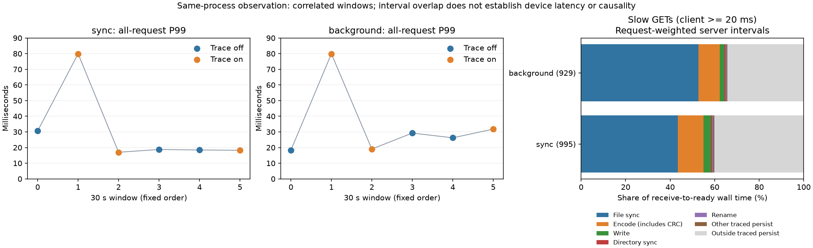

# 三机持久化时间关联证据

运行核心：`27baea4d528ee3d372b6b523996f36508c6ca16b`。详细解释与限制见[报告](../../../docs/cloud-persistence-trace-20261025.md)，字段契约见[持久化追踪](../../../docs/persistence-tracing.md)。

正式活动：12 个 30 秒窗口，212,268 次请求成功、0 失败，3,732 / 216,000 个计划时刻未发。三机、单 Group、15 MiB 冷 value、32 连接、600 次／秒计划到达、50% 写入；sync／background 各关／开／开／关／关／开，默认 adaptive 与 4 MiB journal。客户端和控制程序与 Follower 3 共置，每组只有三个相关窗口。另保留 4 个 2 秒烟测窗口（4,723 成功、77 未发），不混入正式结果。

开启组 53,065 个 GET 全部关联，覆盖与退出摘要均通过；24 个进程生命周期日志无丢弃、限额、截断或 I/O 失败。慢 GET（客户端 ≥20 ms）995／929 个，Leader 同线程持久化与服务端接收至响应就绪区间的累计交集为 59.82%／65.69%。交集使用请求加权墙钟时间，文件同步区间含调度等待，不能当作设备延迟、利用率、因果分解或可实现收益。

追踪增加 CPU 消耗，后台编码开启组 P99 中位数 26.220 → 31.790 ms。全窗口最大请求 376.734 ms。默认关闭追踪；后台磁盘发布尚未实现。这轮不构成独立容量、多日稳定性或严格编码优劣对照。

## 离线核验

在仓库根目录运行，Python 标准库即可，无须 SSH 或执行归档中的脚本：

```bash
python3 scripts/verify-persistence-trace.py benchmarks/published/persistence-trace-20261025
python3 tests/test_persistence_evidence.py
```

核验包括公开清单、冻结源码与执行工具、普通／sanitizer 各 154 项日志、客户端编号范围及到达日历、实际读写混合、开关与 Leader／任期、资源、持久化计数差分、24 个追踪退出摘要、正式及烟测原始请求与逐 GET 交集、两组正式恢复及两组烟测恢复、原服务／512＋4 个值保护和实验服务清理。语义负例单独计数，不加入 CTest 的 154 项。

## 文件

| 文件 | 含义 |
| --- | --- |
| `nodes/node-{1,2,3}.tar.gz` | 三节点完整实验日志、数值追踪；node 3 另含正式／烟测逐连接样本、命令、状态、资源与恢复记录 |
| `source/runtime-source*` | 实际构建程序的源码包及文件摘要，保持原包字节 |
| `source/core-source*` | 对应核心提交的 C++／Python、CMake 与测试源码；运行源码逐文件匹配 |
| `source/executed-tools*` | 11 个实际执行工具及摘要，匹配执行记录 |
| `control/` | 版本、二进制、构建、部署、门槛修正、原服务与环境核验 |
| `tests/` | 最终普通／ASan/UBSan 完整日志与 LastTest；本地 GCC 15.2.0，云端 GCC 13.3.0，范围分列 |
| `derived/summary.json` | 12 个正式窗口与四个开关组合的可复算数据；分位数是窗口分位数中位数 |
| `derived/smoke-summary.json` | 单独的 4 个烟测窗口 |
| `derived/captures.json` | 24 个追踪生命周期的退出摘要与字节数 |
| `derived/timelines/*.json.gz` | 六个开启窗口逐 GET 的身份、服务端时间和区间交集 |
| `figures/tracing.png` | 全部窗口 P99 与慢 GET 加权阶段交集；由当前 `benchmarks/plot_persistence_trace.py` 生成 |
| `manifest.json` / `publication-manifest.json` | 范围、变换说明及全部公开文件摘要 |

数值 JSON、客户端 gzip 与追踪 JSONL 的原始字节保持不变，内层 `export.json` 保留采集时的文件摘要；本轮诊断命令和文本中的 IP、主机名、私有路径与服务标签统一替换，外层清单记录公开字节。冻结源码保留提交原文，包括先前已提交的静态私网测试样例，与本轮运行端点记录分开处理。未公开 SSH 材料、控制 token、数据库文件或二进制。源码归档只供查看和核对，核验器使用仓库当前实现。


