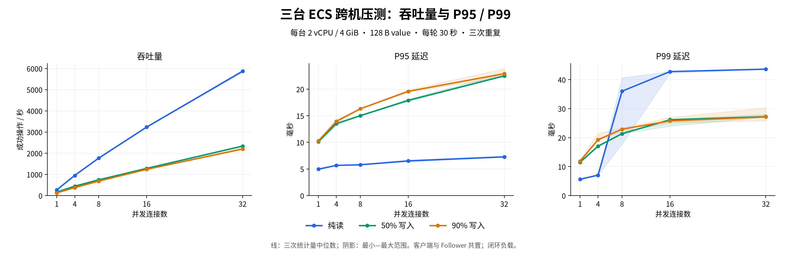
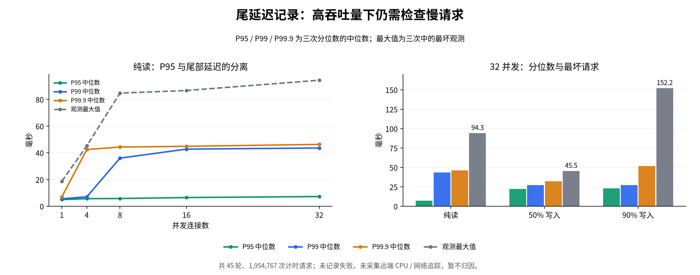

# 2026-10-24：三台 ECS 跨机性能基线

三台虚拟机各运行一个 Raft voter，客户端与节点 3 的 Follower 共用机器。在 128 B value、独立客户端 key、每连接一个在途请求的闭环负载下，完成 **45 轮、1,954,767 次计时请求，未记录请求失败**。32 并发时，三次吞吐量中位数分别为纯读 **5,868.4 ops/s**、50% 写入 **2,336.8 ops/s**、90% 写入 **2,200.9 ops/s**。

结果补充了此前[三台 ECS 基础正确性演练](cloud-acceptance-20261023.md)，不是同机性能数字的重用。高并发纯读仍有明显尾延迟；写占 90% 的轮次中最慢单次请求为 **152.175 ms**。本报告保留全部重复、波动和最大值，不据此宣称生产容量或故障期间的性能保证。

证据、环境、源码和重算入口见[公开归档](../benchmarks/published/cloud-performance-20261023/README.md)，全部 15 个组合的机器可读结果见 [CSV](../benchmarks/published/cloud-performance-20261023/summary.csv) 和 [JSON](../benchmarks/published/cloud-performance-20261023/analysis.json)。

## 32 并发下的结果

| 请求组合 | 吞吐量中位数 ops/s | P95 ms | P99 ms | P99.9 ms | 最坏单次 ms |
| --- | ---: | ---: | ---: | ---: | ---: |
| 纯 GET | 5,868.4 | 7.269 | 43.611 | 46.310 | 94.335 |
| 50% PUT / 50% GET | 2,336.8 | 22.488 | 27.235 | 32.181 | 45.538 |
| 90% PUT / 10% GET | 2,200.9 | 22.899 | 27.125 | 51.938 | 152.175 |

吞吐量与各分位数列是**三个独立轮次对应统计量的中位数**。最后一列是三次中最慢的单次请求，不是三个最大值的中位数。混合负载的表格分位数包括 GET 与 PUT；按操作拆分的数据另存于 JSON。



线是中位数，阴影是三次的最小—最大范围；三轮独立重复不等同于置信区间。原始矢量图可从归档中的 `figures/concurrency.svg` 导出。

## 环境、版本与负载

| 项目 | 实际记录 |
| --- | --- |
| 云资源 | 三台阿里云 ECS，同一杭州 VPC；经济型 e、2 vCPU / 配置 4 GiB、40 GiB ESSD Entry，资源规格沿用此前控制台记录 |
| 本次环境记录 | 三份均为 Ubuntu 24.04.5 LTS、Linux 6.8.0-139、x86_64、2 个逻辑 CPU；暴露的型号为 Intel Xeon Platinum，KVM；MemTotal 约 3.5 GiB，无 swap |
| 节点程序 | 已安装文件 SHA-256 与先前验收的 `909df76` 二进制一致；三台节点和客户端分别同哈希 |
| 压测程序 | 干净 Git 提交 `c1b238c`；归档中两份 Python 工具副本与该版本一致 |
| Raft 与持久化 | 三 voter、单 Group；journal、ReadIndex、自适应快照；保留已安装服务的参数 |
| 发压位置 | 节点 3 的机器；状态检查中节点 2 为 Leader，term=96 |
| 客户端模型 | 最多两个 Python 进程，进程内分配连接线程；TCP 长连接、TCP_NODELAY；每连接一个请求在途，无失败请求自动重试 |
| 并发与负载 | 1、4、8、16、32 连接；目标 PUT 比例 0%、50%、90%；128 B value，每连接 8 个独立 key |
| 时长与顺序 | 每连接预热 5 秒，正式窗口 30 秒；每组合 3 次，固定种子打乱每个重复内的顺序 |
| 实验区间 | 北京时间 2026-10-23 23:38:35.374 至 2026-10-24 00:05:35.926；manifest 区间约 27 分钟 |

没有为此次测量替换已安装的节点。只更新压测工具的 Git 工作目录，不能把工具提交 `c1b238c` 当作正在运行的新节点版本。三份环境记录都采集于发压前，第三台的程序哈希、服务 PID、配置和 boot ID 在发压前后相同。其他两台没有末尾 PID 快照，不将采样间没有观察到变化表述为连续进程监控。

样本计时使用同一发压机的单调时钟。吞吐量分母从释放所有连接前开始，到最后一个计时请求完成为止，包含结束时在途请求的完成时间。45 轮分母合计 **1,350.272 秒**，建连、预填、预热、最终 GET 校验不计入其中。延迟包括客户端值构造与编解码、网络、服务处理、响应解码和校验；客户端请求选择在单次计时开始前完成。

每次 GET 校验对应客户端 key 的预期版本。客户端 key 相互独立，结果不是跨客户端同 key 并发历史的线性化模型校验。预热按目标比例随机读写，实际计时 PUT 比例由样本单独计数。

## 全部组合与三次波动

每行成功操作数合计三个计时轮次，范围是三个轮次的吞吐量最小—最大值。没有把不同负载的全部样本混合成一个性能分位数。

| 请求组合 | 并发 | 成功操作数 | 吞吐中位数 ops/s | 吞吐范围 ops/s | P95 ms | P99 ms |
| --- | ---: | ---: | ---: | --- | ---: | ---: |
| 纯 GET | 1 | 24,122 | 268.5 | 264.4–271.2 | 4.964 | 5.613 |
| 纯 GET | 4 | 85,929 | 952.5 | 950.5–961.0 | 5.672 | 7.054 |
| 纯 GET | 8 | 159,433 | 1,768.8 | 1,747.1–1,798.0 | 5.787 | 36.006 |
| 纯 GET | 16 | 290,492 | 3,233.8 | 3,213.2–3,235.1 | 6.514 | 42.763 |
| 纯 GET | 32 | 529,095 | 5,868.4 | 5,821.0–5,943.8 | 7.269 | 43.611 |
| 50% 写入 | 1 | 14,803 | 165.3 | 162.3–165.7 | 10.143 | 11.516 |
| 50% 写入 | 4 | 40,139 | 443.8 | 443.1–450.8 | 13.522 | 17.038 |
| 50% 写入 | 8 | 66,922 | 743.1 | 743.1–743.9 | 15.013 | 21.330 |
| 50% 写入 | 16 | 116,404 | 1,283.3 | 1,276.1–1,319.5 | 17.890 | 26.152 |
| 50% 写入 | 32 | 209,726 | 2,336.8 | 2,315.4–2,337.0 | 22.488 | 27.235 |
| 90% 写入 | 1 | 11,485 | 126.5 | 126.3–129.9 | 10.282 | 11.921 |
| 90% 写入 | 4 | 33,769 | 375.3 | 369.2–380.9 | 13.950 | 19.256 |
| 90% 写入 | 8 | 61,244 | 682.2 | 674.8–684.0 | 16.307 | 22.895 |
| 90% 写入 | 16 | 112,054 | 1,237.7 | 1,234.0–1,261.5 | 19.586 | 25.765 |
| 90% 写入 | 32 | 199,150 | 2,200.9 | 2,163.1–2,272.1 | 22.899 | 27.125 |

全部计时请求为 **599,523 次 PUT + 1,355,244 次 GET**。实际 PUT 比例在各均衡组合中约为 49.80%–50.14%，各写密集组合约为 89.89%–90.13%。计时失败数为 0。

## 尾延迟与尚待定位的问题



纯读从 4 到 8 并发时，P95 中位数从 5.672 到 5.787 ms，P99 中位数却从 7.054 到 36.006 ms。8 并发的三次 P99 分别为 **17.738、40.644、36.006 ms**，显示出与吞吐量波动不同的尾部波动。16 / 32 并发的纯读 P99 中位数分别为 42.763 / 43.611 ms。只报告平均延迟或 P95 会遗漏这些现象。

90% 写入、32 并发的三次 P99.9 为 **51.938、31.098、88.031 ms**，最大值分别为 **92.095、40.832、152.175 ms**。P99 中位数 27.125 ms 并不意味着单次请求都在这个时间内完成。低并发写密集轮次每次仅约 3,800 个样本，P99.9 对应很少的慢请求，不据此给出稳定性 SLA。

152.175 ms 对应写密集第三次轮次中的一个 **GET**；同一轮 PUT 的最坏单次为 102.746 ms。请求种类与负载名称分别保留在原始记录中。

采样没有远端两个节点的逐秒 CPU/RSS、网络抓包或请求与同步写盘的关联时间线。本轮不足以把尾部归因于某个节点 CPU、TCP 行为或检查点。客户端采样 CPU、RSS、发压机 CPU tick 与三节点状态仍已保存，后续可据此设计有服务端监测和请求关联的实验。

## 写入、复制与旧值核对

独立核验器从原始样本重新计算每个轮次的 PUT/GET 数量、实际分母及最近秩分位数，得到与原压测工具完全一致的数值。每个轮次结束后，三个节点的 `last_index / commit_index / applied_index` 一致；预热后到结束的日志位置增长量恰好等于该轮计时 PUT 数。所有只读轮次在计时与收尾区间的日志位置和持久化写入字节增长均为 0。

整组日志位置可以逐项核对：

```text
初始位置                         2,294
一次性预填最大 keyspace             256
45 轮按连接重置的预填              4,392
预热 PUT（由客户端最终版本反推）   100,611
计时 PUT                        599,523
最终位置                        707,076
```

三节点的阶段状态快照均保持 Leader ID 2、term=96；其中 `quorum_timeouts`、`busy_rejections`、`pending` 都为 0。最终三台均有 292 个 key，活跃编码快照为 48,374 字节。四个前期验收值在发压前后都相同：`cloud-check=ready`、`failover-check=survived`、`rejoin-check=caught-up`、`reboot-check=alive`。

这不是新的断电或故障活动：计时负载期间没有执行受控服务停止、网络分区或磁盘故障注入。前一次的故障演练仍对应前一次的证据范围。

## 原始材料与复算

操作者上传一个结果压缩包和三份发压前环境记录。输入压缩包 SHA-256 为：

```text
1575b9ce74210860cbbc73c17a594ab48d2357c4130ad526ff7a2a573f6b5d72
```

四份原件保存在仓库外。公开副本替换机器私网地址和主机名；**549 个逐客户端 gzip 请求样本与原件逐字节一致**。时间、请求延迟、操作标志、最终版本、轮次顺序、运行程序哈希和 boot ID 保留。公开清单保存四份输入的文件名、大小和哈希；测试源码快照保持原已公开 Git 版本，不改写其中既有测试地址字面量。

在仓库根目录离线执行，无需连接 ECS：

```bash
python3 scripts/verify-cloud-performance.py benchmarks/published/cloud-performance-20261023
python3 benchmarks/remote_matrix.py --verify benchmarks/published/cloud-performance-20261023/experiment
```

第一个入口还核对三台配置、已安装程序哈希、154 个运行时源码文件、完整 45 轮矩阵、逐客户端版本、复制位置、统计 JSON 和 CSV。数值来自保留记录的一致性检查，不能独立认证远端机器身份。图表重绘方法和渲染版本见归档说明。

## 结论范围与下一步

本次已经补齐现有三机在三种读写负载、五档连接数下的吞吐量、P95/P99、三次波动及原始样本。32 并发是本轮测试上限，吞吐曲线仍在上升，不能把该点称作集群最大容量。当前结果也没有与其他 KV 在相同语义、硬件和负载下做对照。

最大 keyspace 预填后总数据规模固定，但活跃 key 数随并发由 8 增加到 256，不能把它解释为固定热点数条件下只有并发一个变量的对照。已有的 36 个 key 保留，业务热数据规模很小；没有覆盖大数据集或冷启动。客户端与 Follower 共置，Python 调度也进入测量；闭环会在慢响应期间减少发压，不能替代固定到达率下的排队延迟测试。

下一轮优先定位纯读高并发尾延迟：补充三节点逐秒资源与请求关联记录，再以相同程序、并发、数据和重复顺序验证原因。独立发压机、大状态、多日稳定性、带故障的持续并发与云端备份恢复仍属于后续验收。
