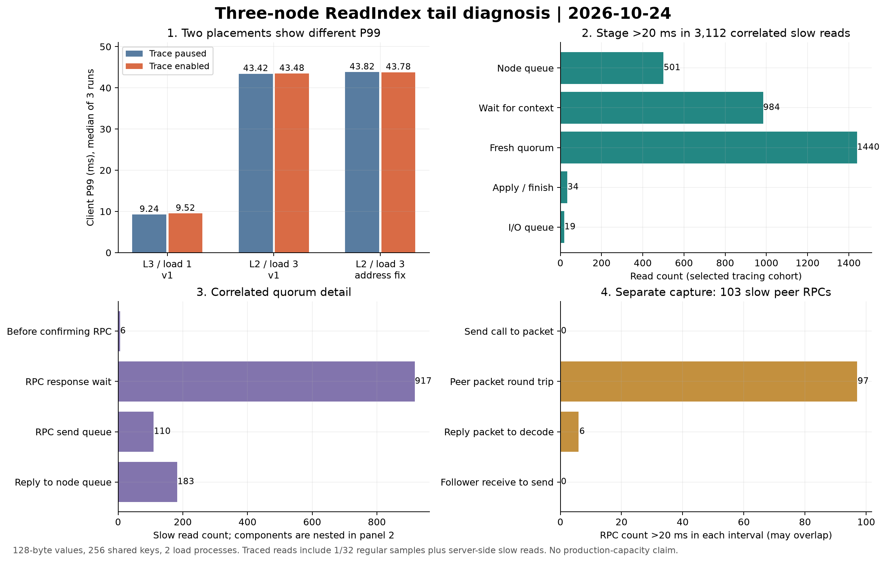

# 三台 ECS 的 ReadIndex 尾延迟诊断与分阶段追踪

日期：2026-10-24。**本轮交付了可关联的读路径追踪，完成 28 轮、2,416,980 次计时 GET，全部成功；约 43 ms 的 P99 仍可复现，没有宣称已经消除。** 原有三台服务已经恢复到实验前的程序，数据保留。

本文保留第一阶段的 28 轮结果与恢复位置。后续追加调度捕获、亲和性对照及原程序复核，结果与最新恢复状态见[后续 20 轮报告](cloud-scheduling-20261024.md)。

有效追踪将 14,357 条计时读与实际确认副本的 RPC 关联，其中 3,112 条端到端超过 20 ms。等待分布在节点队列、分配新读 context 之前、ReadIndex 多数派确认，以及部分线程交接；序列化在这些样本中没有出现超过 20 ms 的停顿。单独抓包进一步区分了收发路径和进程内等待，尚未证明唯一根因。



图中的两种节点分工同时改变了 Leader 和发压机器，且发生在不同时间窗口。它展示条件差异，不能解释为某台物理机器的独立因果效应或代码优化收益。各版本的追踪开关对照在相同进程、Leader、数据集内完成。

## 代码交付

- 默认关闭的 `--trace-prefix` 诊断功能；记录客户端源端口／请求编号、读 context、实际确认副本及 sequence，把读请求串到经过核心校验的多数派回复。
- 拆分网络回调到节点处理、读轮次等待、确认、应用、响应编码、I/O 线程交接；副本 RPC 进一步记录工作线程、发送、响应解码及回复送回节点等阶段。
- 独立写线程进行 JSON 编码和文件写入；待写队列 8192 条，默认事件上限 500,000、文件上限 256 MiB。满队列丢诊断记录，状态与退出摘要保留丢弃／限额／I/O 错误；不将追踪文件当作恢复状态。
- 普通读每 32 条保留一条，并保留在准备响应前已经超过 10 ms 的读；通过控制文件在同一进程内暂停／恢复。所有记录均为数值，不包含 KV key/value。
- 修正网络接收层丢弃客户端地址的问题：由 `accept4` 已返回的地址传入连接，无需增加每次请求的地址查询。真实三进程测试检查两条连接使用相同请求编号时仍可区分。

参数、字段、时钟和采样限制见[读路径追踪](read-tracing.md)。协议决策、网络消息和持久化格式保持兼容；没有放宽每批新读必须获得新鲜多数派确认的条件。

## 负载与版本

沿用三台 2 vCPU／4 GiB 配置、Ubuntu 24.04 的 ECS，每台一个固定 voter；journal、ReadIndex、自适应快照。发压机与一个 Follower 共置，两个 Python 发压进程，每条持久 TCP 连接只有一个在途请求。值长 128 字节，共享 256 个实验键，预热 3 秒、计时 20 秒，闭环发压。

首轮 12 个开关／并发对照使用 Leader 3、节点 1 发压；之后恢复原先的 Leader 2／节点 3 发压，追加 7 个对照及 1 次独立抓包。首轮计时数据可核验，但客户端地址原为占位值，逐读关联无效；修正后用新源码快照、新备份和新目录重跑 7 个关键对照及 1 次抓包。合计 26 个普通对照、2 个独立抓包诊断；抓包结果不混入普通对照。

32 并发各组的统计如下。每格为三轮对应统计量的中位数；不是混合全部请求后的分位数。

| 条件 | 追踪 | 轮次 | ops/s | P95 ms | P99 ms |
| --- | --- | ---: | ---: | ---: | ---: |
| 首轮：Leader 3，节点 1 发压 | 暂停 | 3 | 4,773.6 | 8.075 | 9.245 |
| 首轮：Leader 3，节点 1 发压 | 开启 | 3 | 4,628.7 | 8.276 | 9.516 |
| 首轮：Leader 2，节点 3 发压 | 暂停 | 3 | 5,908.3 | 6.964 | 43.425 |
| 首轮：Leader 2，节点 3 发压 | 开启 | 3 | 5,999.4 | 6.939 | 43.475 |
| 地址修正后：Leader 2，节点 3 发压 | 暂停 | 3 | 5,604.6 | 7.203 | 43.817 |
| 地址修正后：Leader 2，节点 3 发压 | 开启 | 3 | 5,526.6 | 7.341 | 43.784 |

暂停追踪时仍使用配置了记录器的同一程序，写线程继续检查控制文件，因此对照估计的是开启事件记录的额外影响。地址修正后，开启组吞吐中位数约低 1.4%，P99 基本不变；仅三轮且存在环境波动，不能当作普适开销保证。跨版本实验新增了独立的 256 个键，也不能把不同版本的吞吐变化归因于地址修正。

原服务二进制 SHA-256：`6bb46da21f4a3284cace8536eec9d2c8867e67cc9a3f187ea532ef0308575b02`。最终诊断程序：`415a9846c579c97643c346d69c96147c47b584ede45038f8c9379fc103993e8b`。构建基于 `0cfa060d28c633ba75787afcfa3e467f657995aa` 加本轮未提交修改的冻结快照，云端使用 GCC 13.3 编译。最终源码包 SHA-256：`2d944271d2d48d4e8ad757889ab7dd17a15d492789e66def0826d2b65c8f0d0a`。

## 逐请求结果

地址修正后的开启轮次包含 364,910 次计时 GET，其中 6,762 次端到端超过 20 ms。关联成功的 3,112 条慢读中，各阶段自身超过 20 ms 的计数为：

| 阶段 | 慢读数量 |
| --- | ---: |
| 网络回调后等待节点处理 | 501 |
| 处理后等待分配新的读 context | 984 |
| context 创建至获得本轮多数派确认 | 1,440 |
| 确认后的应用检查与响应准备 | 34 |
| 响应交给 I/O 线程前的等待 | 19 |
| 响应序列化 | 0 |

其中实际确认副本的 RPC 响应等待超过 20 ms 有 917 条；回复送回节点队列有 183 条，RPC 完成后发送线程获知结果有 144 条。读与 RPC 的 context、任期、sequence 全部一致；关联歧义与确认副本记录缺失均为 0。

这些是墙钟区间，包含线程暂停和调度等待，不能等同于该段代码消耗了相同 CPU 时间。计数可能重叠，RPC 子阶段又包含在多数派确认区间内，不能相加。追踪还偏向准备响应前已变慢的读；它没有覆盖全部端到端慢请求，不能用这个群体推导全量 P99 或所有长尾的根因占比。

## 单独抓包结果

最终诊断轮次的 109,806 次计时 GET 全部匹配客户端和 Leader 两端包记录，其中 2,240 次端到端超过 20 ms。1,044 条慢读同时具有读阶段和实际确认 RPC 的包记录；这些实际确认副本的收包至发包最长仅 0.336 ms。

共关联到 103 条响应等待超过 20 ms 的副本 RPC：97 条在 Leader 包记录中的往返已经超过 20 ms；另有 6 条在回复包到达至用户态解码之间超过 20 ms。这两组在本次捕获中没有交集。发送调用至请求包记录没有超过 20 ms 的样本。在匹配到副本双端记录的 101 条中，副本服务区间没有超过 20 ms，93 条的往返减去副本服务区间仍超过 20 ms。

这里的路径剩余时间还包含内核、虚拟网络和虚拟化调度，不能直接命名为物理网络延迟。所有持续时间只在单机时钟内相减；代码到包记录的点位使用同机成对时钟校准，最大读时钟区间约 2.5 微秒，捕获前后偏移变化小于 1 微秒。抓包每台最长 28 秒、600,000 个包、96 字节截断；截断／合并或未匹配帧排除。抓包有开销，这一轮用于定位。

计时纯读区间没有日志位置或持久化字节增长，不能用同步检查点解释这一批结果。恢复后的系统检查也未发现显式 CPU 配额、固定绑核或实时调度；父 cgroup 累计节流计数为 0。这些检查仍不能排除云宿主和收发路径抖动，也没有证明某个具体调度策略或 Nagle 是唯一原因。

## 验证与恢复

开发机上的最终源码普通 CTest **134/134**、ASan／UBSan **134/134** 通过；云端构建后执行真实集群关联检查和上述实验，未重跑云端全量 CTest。记录器组件的 ThreadSanitizer **4/4** 通过，其源码与最终版本一致；没有把这一项说成整个项目的 TSan 验收。新增回归覆盖有界资源、并发提交、开关、真实连接关联、超时所有权、旧 Leader 失去多数派时拒绝读、纯读无持久化增长。clang-format 18 与 diff 空白检查通过。

每次切换前都停服务取得一致的三节点备份；实验程序使用独立路径和 `/run` 中的临时服务覆盖项。两轮结束后移除本轮覆盖项并恢复原程序，不回滚用户数据。最终三台应用／提交／末尾位置均为 **711082**，共 **2852 个键**，原有四个检查值和两轮新增的 **512 个实验键**全部读取验证通过；无遗留实验后台任务。相对开始位置新增 518 条，由 512 次预装 PUT 和 6 次新 Leader 的 no-op 组成，计时 GET 没有追加日志。

## 证据与后续

当前完整证据保留在仓库外的本地工作区 `/home/hermes/yeyu/cloud-read-trace-20261024`：冻结源码、构建与回归日志、三端文件清单、逐请求样本、数值追踪、包记录和离线分析均保留。业务备份和运行程序留在私有实验材料中；密钥不在源码包或项目仓库内。本报告与图表是摘要，**新增原始证据尚未整理为公开归档**，不能仅凭仓库中的摘要独立核验所有新增结果。

本地离线核验无需 SSH 或第三方 Python 依赖，也不执行归档内代码：

```bash
python3 /home/hermes/yeyu/cloud-read-trace-20261024/tools/verify_artifacts.py \
  /home/hermes/yeyu/cloud-read-trace-20261024
```

核验源码／下载／文件哈希、测试日志、全部逐请求成功标志、最近秩分位数、吞吐计算、读窗口持久化不变、追踪退出摘要及恢复记录。首轮逐读关联明确标为无效，修正轮关联标为有效；不会把缺少关联的记录当作定位成功。核验保证保留材料内部一致，不能独立认证远端机器或证明生产容量。

接下来优先用固定代码和负载做调度与路径对照，并采样线程唤醒／运行等待，解释为什么约 40 ms 会分布在多个墙钟区间；如要改读调度，再针对证据中的排队环节做受控 A/B，并保留新鲜多数派与应用屏障回归。当前没有依据优先做序列化微优化，或通过放宽一致性条件来消除尾延迟。

求职时可准确描述为：实现有界异步追踪，将客户端请求、ReadIndex context 与实际多数派 RPC 关联；通过三台 ECS 的逐请求样本、三端包记录、运行期开关对照和 sanitizer 验证拆分尾延迟。不要将节点分工变化产生的 P99 差异写成代码提速。
