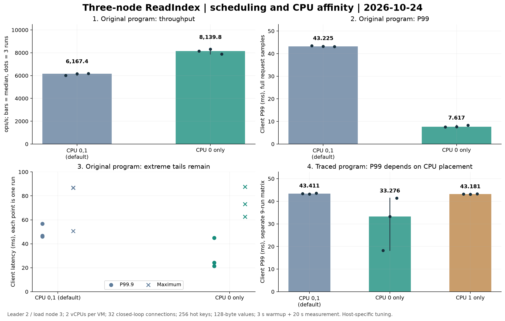

# 三台 ECS 的调度追踪与 CPU 亲和性对照

日期：2026-10-24。**在原先部署、未开启追踪的程序上，仅将 Leader 2 的全部线程限制在 CPU 0，三轮纯读吞吐中位数从 6,167.4 提升至 8,139.8 ops/s（+32.0%），P99 从 43.225 降至 7.617 ms（−82.4%）。** 这是固定云环境和负载下的部署调优结果；仍有单次 87.525 ms 的请求，未证明长尾全部消失。

本次追加 20 轮、2,607,683 次计时 GET，失败为 0。连同[前一阶段追踪实验](cloud-read-trace-20261024.md)，累计 48 轮、5,024,663 次计时 GET。两次抓包和两次调度捕获属于诊断轮次，分别保留，不混入普通对照的三轮中位数。实验结束后三台已恢复原程序、默认 CPU 亲和性和原服务配置。



图中点为单轮统计量，柱为三轮中位数；分位数来自该轮完整客户端样本，不是从服务端采样日志估计，也不是合并三轮后计算的分位数。两种程序分别完成各自的对照，不能把跨程序差异全部归因于追踪开销。

## 条件与顺序

- 三台 ECS，每台 2 vCPU／4 GiB，Ubuntu 24.04、Linux 6.8.0-139；固定三个 voter、单 Raft Group，journal、ReadIndex、自适应快照。
- Leader 固定为节点 2，节点 3 上两个 Python 进程发压，并与 Follower 共置。32 条持久连接，每条只有一个在途请求；256 个共享热键、128 字节 value，预热 3 秒、计时 20 秒。最后在途请求的排空计入吞吐时间，建连、预装、预热和最终值校验不计入。
- 先在追踪程序上执行 5 轮调度对照，再执行 9 轮 CPU 亲和性对照；恢复原程序后，另做 6 轮验证。三个矩阵各自固定进程、任期、Leader 和数据集；只读矩阵没有新增 PUT。跨矩阵发生服务切换与选举，不能直接作单因素比较。
- 只改变 Leader 2 的**全部线程**允许使用的 CPU：默认 `{0,1}`、仅 `{0}`、仅 `{1}`。没有改变其他节点、IRQ 设置、内核调度策略或云安全组件。每轮前后记录所有线程的实际掩码与 PID。
- 追踪程序三次顺序依次为“默认／CPU 0／CPU 1”“CPU 0／CPU 1／默认”“CPU 1／默认／CPU 0”；原程序顺序为“默认／CPU 0”“CPU 0／默认”“默认／CPU 0”，以减少固定运行顺序造成的偏差。

闭环发压、客户端与 Follower 共置，以及有限时长会限制结论；这些数字不是独立发压机、开环延迟或生产容量承诺。

## 原程序：六轮完整结果

| 轮次 | CPU 掩码 | 计时 GET | ops/s | P95 ms | P99 ms | P99.9 ms | 最大 ms |
| --- | --- | ---: | ---: | ---: | ---: | ---: | ---: |
| 1 | 0,1 | 120,447 | 6,021.3 | 7.350 | 43.525 | 45.962 | 50.629 |
| 1 | 0 | 162,840 | 8,139.8 | 5.682 | 7.569 | 24.187 | 62.557 |
| 2 | 0 | 166,299 | 8,313.3 | 5.574 | 7.617 | 21.375 | 73.132 |
| 2 | 0,1 | 123,387 | 6,167.4 | 6.855 | 43.225 | 56.714 | 86.627 |
| 3 | 0,1 | 123,983 | 6,188.2 | 7.106 | 43.162 | 46.789 | 86.872 |
| 3 | 0 | 157,945 | 7,895.6 | 5.638 | 8.325 | 44.888 | 87.525 |

共 854,901 次计时 GET，全部成功。同一 Leader 进程 PID 51247，任期 114；每轮的日志位置和持久化字节均未增长，服务没有重启。CPU 0 组的吞吐为 7,895.6–8,313.3 ops/s，P99 为 7.569–8.325 ms；默认组的对应范围为 6,021.3–6,188.2 ops/s、43.162–43.525 ms。

CPU 0 组 P99.9 的三轮中位数为 24.187 ms，第三轮仍达到 44.888 ms；观测到的最坏单次值 87.525 ms 还略高于默认组的 86.872 ms。只能说本次 P99 和吞吐改善稳定复现，不能说极端尾延迟已经解决。

原程序 SHA-256 为 `6bb46da21f4a3284cace8536eec9d2c8867e67cc9a3f187ea532ef0308575b02`，对应此前验收的 `909df769ae2d9b0579a31f9d89745e589da86819` 运行版本。六轮期间运行文件、服务配置、进程和数据集均保持一致。其冻结源码与文件清单来自既有[云端公开基线](../benchmarks/published/cloud-performance-20261023/README.md)，并在本地再次核对归档内逐文件哈希。

## 追踪程序：保留波动与 CPU 1 对照

9 轮、1,160,724 次计时 GET，全部成功。每种掩码三轮；下表的 ops/s、P95、P99 为各轮统计量的中位数。

| 掩码 | ops/s | P95 ms | P99 ms | 三轮 P99 范围 ms |
| --- | ---: | ---: | ---: | ---: |
| 0,1 | 5,972.3 | 7.214 | 43.411 | 43.199–43.596 |
| 0 | 6,844.5 | 6.419 | 33.276 | 18.189–41.401 |
| 1 | 6,518.0 | 6.257 | 43.181 | 43.063–43.277 |

这一矩阵中 CPU 0 的 P99 波动明显，CPU 1 的 P99 仍约 43 ms；所以才追加原程序对照。CPU 1 的结果来自追踪程序，未另测原程序的 CPU 1。追踪写线程也在被绑核的线程集合内，不能用两种程序间的差异推导一个通用的追踪开销百分比。

## 调度事件解释了什么

此前读阶段和三端包记录已经显示，约 40 ms 会出现在多个等待区间。本轮新增 Linux TID 字段，把请求的节点线程、网络线程、实际确认副本的发送线程和 RPC I/O 线程关联到 `sched_wakeup / sched_switch`。TID 在线程内缓存，不为每条请求额外查询一次系统调用。

5 轮调度矩阵共 592,058 次计时 GET：3 轮普通追踪对照，2 轮额外捕获 Leader 机器的全系统调度事件。普通组吞吐中位数 5,954.1 ops/s、P99 43.478 ms；捕获组两个值的中位数分别为 5,858.2 ops/s、43.656 ms。捕获存在额外开销，这些轮次用于定位。

两次各 35 秒的捕获使用单调时钟，累计解析 **1,722,899 条**唤醒／切换事件；未发现丢事件、未解析行、时间倒序或 CPU 切换序列缺口。5 轮中共关联 23,406 条计时读；其中 **9,380 条**处在调度捕获轮次，均落入捕获时间窗。关键线程出现 30 个超过 10 ms 的独立可运行等待区间，节点线程最长约 40.550 ms。一个区间会影响多条请求，因此不能将请求数解释为独立调度次数。

下表限定于这 9,380 条已关联读；第一列计数为阶段本身超过 20 ms，第二列为这些读在该阶段内对应等待线程累计“已可运行、尚未上 CPU”超过 10 ms。

| 阶段 | 阶段超过 20 ms 的读数 | 等待线程可运行等待超过 10 ms |
| --- | ---: | ---: |
| 网络回调至节点处理 | 316 | 17 |
| 处理后等待新 context | 624 | 62 |
| 等待本轮多数派 | 946 | 100 |
| 实际确认副本的 RPC 响应等待 | 681 | 13 |
| RPC 完成至发送线程获知结果 | 114 | 13 |

调度事件证实部分长等待中线程已被唤醒却迟迟未运行，但大多数慢 RPC 的等待线程在 guest 内仍处于阻塞状态。某些约 40 ms 的可运行等待期间，两颗 guest CPU 的记录又大部分显示 idle，例如 40.360 ms 的节点等待窗口中分别 idle 40.360／40.074 ms。这些观测不足以把全部长尾归为普通的 guest CPU 争抢，也不足以锁定某个宿主机、虚拟网络或内核缺陷。

“可运行等待”由唤醒到真正切入、或被抢占后的再次切入重建，依据 [Linux 6.8 调度 tracepoint 定义](https://raw.githubusercontent.com/torvalds/linux/v6.8/include/trace/events/sched.h)。切换记录中的 running 是 guest 内标记的墙钟区间，不等于实际执行指令的 CPU 时间；sleeping 也不能单独区分逻辑等待、网络等待或通知到达较晚。采样追踪偏向准备响应前已变慢的读，不能据此推算全量长尾的根因占比。

固定 CPU 0 改变了线程放置、迁移和交接条件，并产生了可测收益；现有证据仍未证明其中哪一项是唯一机制。不能将调优结果写成修改 Raft 算法带来的提速。

## 代码、验证与恢复

当前交付保留默认关闭、有界异步写入的[读路径追踪](read-tracing.md)，并增加各阶段 TID；ReadIndex 仍要求新鲜多数派确认与应用屏障。没有更改持久化格式或放宽一致性条件。

诊断源码为 `0cfa060d28c633ba75787afcfa3e467f657995aa` 加本轮未提交修改的冻结快照，源码包 SHA-256：`76938c75003f7dbbe894b725421c23127f3407500a96bd58a51b6e3903280a75`；云端 GCC 13.3 编译，三台诊断程序 SHA-256：`22ad75d7dd5d8b3d211eca41354d11605b1eac11cac042db43c2649efda76899`。调度和诊断绑核矩阵使用相同程序。

开发机普通 CTest **134/134**、ASan／UBSan **134/134** 通过；RPC 组件 TSan **9/9**、记录器组件 TSan **4/4**，不代表全项目 TSan 验收。调度解析另有 3 项回归，覆盖唤醒、抢占、阻塞、丢事件与序列缺口；真实性能阶段没有并行运行构建或测试。云端为关闭测试的独立构建，执行集群检查及实验，未重新跑云端完整 CTest。

原程序矩阵准备阶段曾有一次只读 SSH 等待会话以 255 退出，发生在计时负载和亲和性修改之前；选举辅助程序在退出时恢复了暂停节点，随后独立核对三台均在运行，再重试准备。该失败记录保留，没有将其计入“计时请求失败为 0”，也没有重放任何计时写入。

服务切换前保留一致的三节点停机备份；临时程序使用独立路径和 `/run` 覆盖项。最终移除覆盖项，原程序继续运行，全部线程的允许 CPU 恢复 `{0,1}`，无遗留实验后台服务。最终 Leader 2、任期 114；三台 last／commit／applied 均为 **711089**，共 **2852 个键**。原有四个检查值和两轮预装的 **512 个实验键**全部读取正确。本次追加矩阵未新增键，日志位置的变化来自选举 no-op。

## 可复现材料与部署选项

后续已整理 [48 轮公开数值证据](../benchmarks/published/cloud-diagnosis-20261024/README.md)：完整客户端样本、压缩数值追踪、解码调度事件、冻结源码、历史回归日志、绑核记录和恢复检查均可离线核验。导出诊断文本中的节点身份与私有路径已经映射。业务备份、密钥、运行程序、原始 perf.data 和包捕获保留在本地私有目录；抓包摘要的独立包级重算仍需私有捕获。

无需 SSH 和第三方 Python 依赖，检出仓库即可核验全部 48 轮的公开数值证据：

```bash
python3 scripts/verify-cloud-diagnosis.py benchmarks/published/cloud-diagnosis-20261024
python3 tests/test_cloud_diagnosis_evidence.py
```

该工具重算逐请求成功标志、最近秩分位数、吞吐及纯读窗口，校验源码／下载／文件哈希和恢复记录，并重新解析调度事件；不执行归档内的程序。首轮客户端地址缺失导致的读关联无效状态仍保留。它核验材料内部一致性，不独立认证远端机器或证明生产容量。追加 20 轮的逐轮汇总见本地 `affinity/analysis/followup-runs.csv`。

仓库提供可选的 [CPU 亲和性覆盖项示例](../deploy/systemd/cpu-affinity.conf.example)，**未安装到云端，默认服务模板也未启用绑核**。若后续在相同机器上采用，应先保留新基线，并单独验证混合写入、快照、故障接管及 CPU 更高负载；单核限制可能降低这些场景的容量。

示例使用 systemd 的 `CPUAffinity=` 清空先前赋值，再指定 CPU 0，其语义见 [systemd 255 官方文档](https://www.freedesktop.org/software/systemd/man/255/systemd.exec.html#CPUAffinity=)。选择采用时，在节点 2 将示例安装为 `/etc/systemd/system/yewukv-node@2.service.d/50-cpu-affinity.conf`，重新加载并重启对应服务；重启可能触发 Leader 转移，测量前须重新核对角色和所有线程掩码。回滚只删除这个命名文件，重新加载并重启，不删除其他覆盖项。运行中逐线程绑核与服务重启后的长期表现仍需分别验证。

求职时可据实表述：在三台 ECS 上实现请求／ReadIndex／实际多数派 RPC 的关联追踪，结合调度事件与原程序交错对照定位尾延迟；在固定 32 连接纯读负载下，通过 Leader 线程 CPU 放置调优将吞吐中位数提升约 32%、P99 降低约 82%，保留 P99.9、最大延迟、失败记录和恢复验证。公开数值证据现已补齐；独立发压机仍待补充，不直接推广 CPU 0 为默认配置。
