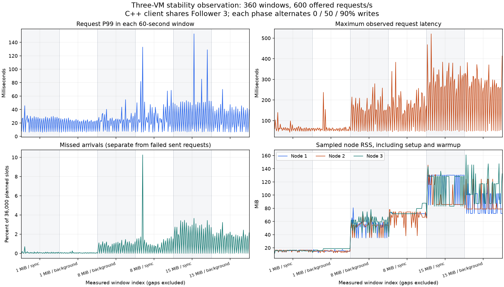

# 六小时三机稳定性与恢复验收（2026-10-24 / 25）

六个相位、360 个 60 秒窗口全部完成，共 21,600 秒计时负载。12,872,548 次已发请求均返回成功，另有 87,452 个计划时刻未发出，占 0.674784%。每个相位整组重启后，冷键、256 个热键与锚值的内容及 revision 检查通过。原有三机服务、512 个实验保护键和另外 4 个保护值保持原状。

实验从北京时间 **2026-10-24 22:13:57** 运行到 **2026-10-25 04:26:35**，墙钟约 **6 小时 12 分 38 秒**。计时负载之间另有预装、预热、样本压缩、检查和重启。两次短烟测单列，不并入正式结果。完整[公开证据](../benchmarks/published/cloud-soak-20261024/README.md)包含全部 11,520 份逐连接样本、命令、资源采样、重启记录、冻结源码和离线重算入口。

## 条件与计数口径

- 三台同地域的 2 vCPU / 4 GiB ECS，各运行一个独立实验节点；C++ 发压器与节点 3 的 Follower 共置，原有服务继续运行。每个实验节点和发压控制服务各有 1 核 CPU 配额、512 MiB 内存上限；C++ 客户端与 Python 控制进程共享该控制服务的额度。
- 六个相位依次为 1 MiB sync、1 MiB background、8 MiB background、8 MiB sync、15 MiB sync、15 MiB background。每相位一个新数据目录、60 个一分钟窗口；每种配置仅一个长相位。
- 默认 adaptive、128 条／1 MiB 快照阈值、4 MiB journal 检查点、1,500 ms 节点请求期限。32 连接、128 B 热 value、256 个热键，轮换 0／50／90% 写入。
- 每秒计划 600 次请求，每连接最多一个在途请求；错过计划时刻计为未发，不排无限队列、不重放结果未知的写入。共计划 12,960,000 次，实际发出 12,872,548 次，其中 PUT 5,979,848 次、GET 6,892,700 次。
- 每窗口排除连接、256 个热键预装和 1 秒预热，包含请求编码、网络、服务端处理、校验及最后在途请求排空。计划时刻延迟包含客户端迟发；已跳过的时刻没有请求延迟样本，未对它们虚构延迟。

## 尾延迟与资源

下表 P99 为同一相位、同一读写比例的 **20 个窗口 P99 的中位数**，不是合并所有请求的 P99；这些窗口来自同一连续相位、轮换出现且共享进程、磁盘与缓存，不视为 20 次独立重复。最长请求为该相位全部已发请求的真实最大值，未发数合计三个比例。

| 冷 value | 编码 | 纯读 P99 | 50% 写 P99 | 90% 写 P99 | 最长请求 | 未发计划数 | 节点 RSS 采样峰值 |
| --- | --- | ---: | ---: | ---: | ---: | ---: | ---: |
| 1 MiB | sync | 6.946 ms | 21.655 ms | 28.037 ms | 139.794 ms | 1,486 | 16.6 MiB |
| 1 MiB | background | 7.042 ms | 21.062 ms | 24.243 ms | 237.229 ms | 999 | 18.8 MiB |
| 8 MiB | background | 7.595 ms | 22.929 ms | 27.252 ms | 279.322 ms | 12,382 | 80.8 MiB |
| 8 MiB | sync | 7.354 ms | 21.130 ms | 44.620 ms | 383.382 ms | 16,770 | 87.8 MiB |
| 15 MiB | sync | 7.371 ms | 24.178 ms | 51.015 ms | 520.703 ms | 31,667 | 145.5 MiB |
| 15 MiB | background | 6.864 ms | 22.256 ms | 41.393 ms | 413.313 ms | 24,148 | 161.0 MiB |



全局最长请求为 **520.703 ms**，位于 15 MiB sync 的第 8 个窗口（50% 写入）。15 MiB background 仍出现 **413.313 ms** 的请求。后台编码组在本次部分写窗口的 P99 较低，但相位顺序、宿主机背景负载和数据演化都不同，没有独立重复，不能把本表的差异当作无偏收益或容量提升。

未发最多的单窗口位于 8 MiB sync 的第 12 个窗口（90% 写入）：36,000 个计划时刻中跳过 3,692 个，约 **10.256%**，实际吞吐约 **538.400 ops/s**。全局平均未发率不能代表每分钟的最坏情况，零请求失败也不表示严格实现了每秒 600 次到达。

所有采样中节点 RSS 峰值约 **160.98 MiB**，低于 480 MiB 的主动停止阈值；采样最低可用磁盘约 **33.37 GiB**。每个配置运行约一小时后更换新进程，且资源为约 10 秒采样，因此不能据此证明长期无内存泄漏或排除采样间短峰值。客户端每窗口重新启动，不能用跨窗口首尾 RSS 估算其内存增长。

## 持久化分阶段观测

下表除最后一列外，均为相位首个窗口前到末个窗口后的 Leader 累计计数差，包含每窗口热键预装、预热、探针和窗口间隙。CRC 已含于编码时间；文件同步含 journal 与检查点相应的被计量调用，不是仅检查点的耗时。不能将这些累计时间当成请求耗时并直接相加。

| 冷 value / 编码 | 检查点次数 | 文件同步累计 s | 目录同步累计 s | CRC 累计 s | 编码累计 s | 快照发布生命周期最大 ms |
| --- | ---: | ---: | ---: | ---: | ---: | ---: |
| 1 MiB / sync | 652 | 1944.942 | 2.516 | 3.895 | 4.974 | 41.055 |
| 1 MiB / background | 652 | 1944.041 | 2.499 | 3.995 | 5.031 | 98.076 |
| 8 MiB / background | 168 | 1918.917 | 0.710 | 6.766 | 8.194 | 262.544 |
| 8 MiB / sync | 167 | 1910.582 | 0.685 | 6.769 | 8.389 | 225.539 |
| 15 MiB / sync | 165 | 1888.004 | 0.700 | 11.524 | 14.938 | 365.062 |
| 15 MiB / background | 166 | 1908.979 | 0.794 | 10.892 | 14.579 | 391.430 |

最后一列是相位进程生命周期截至最后一个窗口的最大值，可能包含冷数据预装；不能将两个最大值相减得到窗口最大值。15 MiB 的后台编码组仍有 **391.430 ms** 快照发布暂停。累计文件同步时间约 1,888–1,945 秒／相位，明显高于该计数范围内 CRC／编码累计时间；这支持下一步优先观测同步 I/O 和事件循环等待。尚未将最长请求与单次持久化事件按时间串联，不能归因某一请求必然由某一检查点造成，也不能排除短时调度停顿。

原始状态保留 16 个非累计耗时桶，核验逐桶求差非负，并核对桶计数与保存次数。精确请求尾延迟仍从客户端样本重算。

## 重启、隔离与收尾

每相位完成负载后，停止并重新启动整组实验节点，核对全部冷键、最后窗口重构出的 256 个热键，以及锚值及原 revision。六个相位合计 6,144 次冷键与 1,536 次热键的 Leader 读取检查，加上 6 次锚值内容／revision 检查；这些是跨相位的检查次数，不能视为互不重复的业务键数量。各检查后等待三个副本提交／应用位置收敛。

全部计时窗口前后 Leader 均为节点 2 且任期稳定；资源记录中每相位节点 PID 和启动时刻不变，无服务重启计数增加。实验自身每约 10 秒检查原服务、节点、磁盘和 RSS，并独立保存进度；本地电脑离线不影响云端实验完成。结束后仅关闭本 tag 的临时节点与控制服务，收集时再次核对临时服务列表为空、原程序哈希不变、原数据位置仍为 711089。

这是健康网络下的计划负载与进程重启验证。没有在本次六小时活动中注入分区或强杀，未覆盖宿主机断电、多日连续运行、独立发压机容量或生产 SLA；故障历史另见[上一轮工程验证](engineering-next-20261024.md)与[CAS 历史](long-window.md)。

## 版本、工具问题与复核

实际运行版本为 `d34a605d0f50727c996fb9c287b40bbe4b8700d7`；冻结的 v2 运行时源码包 SHA-256 为 `229d18219e9345ad2e0fce8ebb5d6ed75a9f5da8a11b30b5685d935369e49cca`。节点程序 SHA-256 为 `fde3cffc1d5068cc8cfe1a731d933dee8a7aab2ef2c4fec6fee2574855b01afa`，C++ 发压器为 `ebfad1b3ca60d446631115dc251c92d601dbe20a507b0a634e25fc43f9a137d2`。运行时源码与九个执行工具分别归档、逐文件核对，采集后的三机部署哈希再次匹配。

本次云端构建关闭了测试目标，未重跑完整 CTest。短任务 `c4c02f1` 的普通／ASan＋UBSan 各 148 项通过；`d34a605` 到达日历修正后，C++ 发压专项在普通／ASan 下各通过一次。日志见[短任务证据](../benchmarks/published/tooling-20261024/README.md)与[日历边界记录](../benchmarks/published/tooling-calendar-20261024/README.md)，不能宣称修正后又重跑了完整 148 项。

保留三个过程问题：初始 schema 1 烟测因整数周期舍入出现 2 个虚假未发，修正为 schema 2 后的新烟测 2,400 个计划全部成功发出，正式窗口全部使用 schema 2；准备阶段 SSH 255 中断元数据上传，在核对实际工具／程序后补全元数据；结束后的收集脚本有生成代码的换行转义错误，修正后重新导出。没有因这些问题覆盖旧样本或重跑正式负载；正式未发数 87,452 不含初始烟测的两个虚假时刻。

```bash
python3 scripts/verify-cloud-soak-publication.py benchmarks/published/cloud-soak-20261024
python3 tests/test_cloud_soak_evidence.py
```

核验只执行当前仓库工具，在临时目录展开分相位压缩包，重算到达日历、逐请求结果、真实读写比例、尾延迟、资源身份、单调计数与派生统计，并核对源码、旧服务保护及两个烟测。证据内归档的历史脚本只作字节校验。公开材料不含私钥、控制凭据、程序、节点数据目录或业务备份。

下一步优先为同步持久化增加单次事件时间关联，再设计保留确认顺序与崩溃恢复契约的后台磁盘发布；随后以相同条件重复对照。当前默认编码仍保持 sync。
