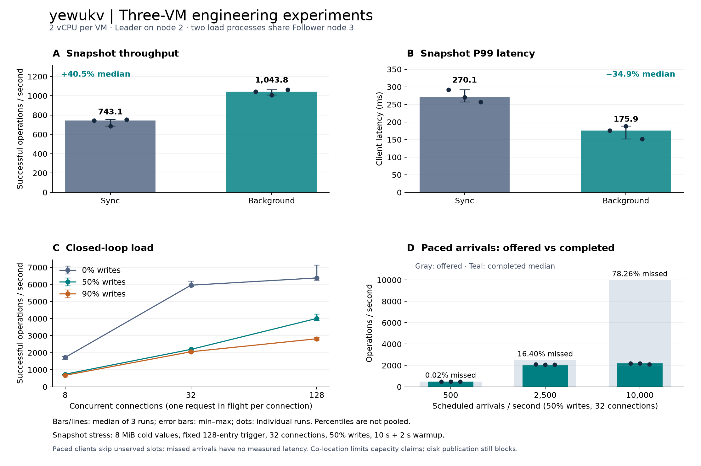

# 三机工程验证：故障、后台快照、负载边界与 CAS

2026-10-24。本轮完成五项工作：公开既有追踪证据、真实三机混合负载故障活动、C++ 后台快照编码、容量与过载探测，以及版本条件更新的配置应用。普通和 ASan／UBSan 各 143 项回归通过，状态机／快照组件的 TSan 13 项通过。

在 **8 MiB 冷 value、固定 128 条日志快照阈值**的压力场景中，同一二进制开启后台编码后，吞吐中位数由 743.143 提高到 1,043.822 ops/s（+40.46%），P99 由 270.133 降至 175.921 ms（−34.88%）。磁盘发布仍同步，后台组最坏请求 299.259 ms，尚未消除长暂停。此结果不代表默认自适应策略的普遍收益。



## 证据与版本

本轮[公开归档](../benchmarks/published/engineering-20261024/README.md)包含全部 48 轮新负载的逐请求样本、故障历史、环境与资源采样、升级／过载探测、实际执行工具、源码和测试日志。正式对照为 42 轮、637,823 次计时请求；另保留 6 轮、47,141 次探索性请求，合计 684,964 次。所有已发出的计时负载请求均成功；故障活动和压力拒绝探测另行计数。

此前读路径与调度的 [48 轮、5,024,663 次 GET 数值证据](../benchmarks/published/cloud-diagnosis-20261024/README.md)也已公开，包含完整解码调度事件，提供独立语义核验。原始包捕获、perf 二进制捕获、业务数据、备份、程序文件和访问凭据均不发布。

| 标识 | 值 |
| --- | --- |
| 本轮云端节点二进制 SHA-256 | `f656e8b6944928ceb971e9be63894a79616edc1bae7c93b1dd5caa61fb9619c1` |
| 冻结运行时源码压缩包 SHA-256 | `efdd9708e60dd8708ae9ec6afe4cd071fc6672fe76d5100f1d9c678216f85514` |
| 原有服务二进制 SHA-256 | `6bb46da21f4a3284cace8536eec9d2c8867e67cc9a3f187ea532ef0308575b02` |

`source/runtime-source.tar.gz` 固定实际云端 C++ 实现；`source/tested-source.tar.gz` 另含最终测试、核验器和工具。归档的工具哈希绑定实际执行字节，探索轮工具与正式轮工具分别保留，避免把后来格式化的文件当作当时执行版本。源码冻结时工作区未提交，不能只用当时 HEAD 代替源码包。

## 环境与测量口径

三台现有 Ubuntu 24.04.5 ECS，各 2 vCPU、配置 4 GiB；客体可见内存约 3.54 GiB，Linux 6.8.0-139，云端 GCC 13.3。私网互联；本轮使用独立端口、独立数据目录和临时服务。未增加第四台机器，两个 Python 发压进程运行在节点 3，与 Follower 共用 CPU、内存和网络。原有集群同时保持服务，因此结果还受共置活动影响。

正式快照和容量对照固定 Leader 为节点 2，计时期间 term／Leader 保持一致。选择 Leader 的暂停操作发生在计时之前；负载期间不再人为固定 CPU。每轮使用新数据目录，128 B 热 value、每连接 8 个独立 key，一个连接最多一个在途请求；请求编码、网络、服务、校验和客户端调度均计入延迟。吞吐时间还包括最后在途请求完成，预装与预热不计入。

表格中吞吐和百分位是**三次运行各自统计量的中位数**，不是合并样本后的百分位；“最坏请求”取三轮最大值的最大值。资源采样约每 0.5 秒一次；CPU 表示平均使用的核数，RSS 为采样峰值，无法保证捕获瞬时最高值。核验器校验各机 `CLK_TCK=100` 和页大小 4096 后再换算。

## 1. 跨机混合负载故障

真实进程与 TCP 代理执行六类故障，各三轮，共 18 轮。每轮三个并发客户端、120 次混合 PUT／GET／DELETE 尝试；故障实施与这些请求的区间相交。故障请求的时间戳统一由节点 3 记录，无需跨机时钟相减。代理支持按发送节点阻断及链路延迟；单向分区只阻断旧 Leader 的出站副本链路。

| 故障 | 轮数 | 实施后开始的首个成功操作完成耗时 ms（各轮） |
| --- | ---: | --- |
| Leader SIGKILL | 3 | 986.8 / 725.4 / 738.2 |
| Leader SIGSTOP／SIGCONT | 3 | 1,750.0 / 1,756.1 / 1,745.7 |
| Leader 双向分区 | 3 | 920.7 / 915.6 / 919.7 |
| Leader 出站单向分区 | 3 | 1,021.4 / 1,753.5 / 768.2 |
| 单节点出站链路追加 40 ms 延迟 | 3 | 24.0 / 26.3 / 17.5 |
| 全组停止／重启 | 3 | 2,666.7 / 2,675.9 / 2,669.2 |

以上是有限、带间隔采样的客户端观察值，且包含故障编排和选举时间，不是协议可用性的精确上下界或一般恢复 SLO。暂停和分区在约 1.5 秒后开始解除；全组重启还需服务启动时间。链路延迟场景可以继续使用未受影响的多数派。

2,160 次流量尝试记录为 1,827 个 OK、256 个 NOT_FOUND、68 个 UNAVAILABLE、9 个 NOT_LEADER；NOT_FOUND 是缺失键的正常读结果。UNAVAILABLE／连接异常后的写入可能已经生效，保留 48 个结果未知写入，不自动重放。将它们建模为可选、完成时间未知的操作，再连同每轮最终读组成 **2,491 个有界模型操作**，所有逐 key 历史通过检查。六次直接访问隔离旧 Leader 的读均拒绝成功。

跨轮次持久值环、初始确认值、落后 Follower 的强制快照追赶和最终整组重启均完成校验。该检查只覆盖保留的单 key PUT／GET／DELETE 历史，不能替代形式化证明；没有真实断电、宿主机故障、多日运行或 CAS 通用历史模型证明。

## 2. C++ 后台快照编码

实现见[所有权与暂停边界](background-snapshot.md)。节点线程冻结 key 及不可变 value 的共享所有权，后台构建与编码快照，节点线程收取结果后按原路径发布、回收日志。最多一个编码任务；新值不会修改旧任务引用，较新安装快照覆盖目标索引时丢弃旧结果，停止节点等待任务退出。确认提交和持久化契约保持同步。

正式对照每轮预装 1,024 个 8 KiB 冷 value，随后 32 个连接、50% PUT、10 秒计时＋2 秒预热。使用 fixed 策略、128 条日志或 1 MiB 触发阈值、64 MiB journal 检查点阈值。三个重复按 sync/background、background/sync、sync/background 交替，合计 53,261 次请求；每轮结束整组重启，逐项读取全部冷数据。

| 模式 | 吞吐中位数（min–max）ops/s | P99 ms | P99.9 ms | 最坏请求 ms |
| --- | ---: | ---: | ---: | ---: |
| sync | 743.143（686.028–754.475） | 270.133 | 309.886 | 374.036 |
| background | 1,043.822（1,007.278–1,062.039） | 175.921 | 204.859 | 299.259 |

| 代价／剩余暂停 | sync 三轮 | background 三轮 |
| --- | --- | --- |
| Leader 平均 CPU 核数 | 0.263 / 0.264 / 0.252 | 0.367 / 0.394 / 0.380 |
| Leader 计时窗口采样 RSS 峰值 MiB | 79.855 / 79.727 / 79.965 | 73.793 / 76.004 / 73.730 |
| 冻结与任务交接最长暂停 ms | 不适用 | 1.217 / 39.322 / 0.694 |
| 发布路径最长暂停 ms | 181.568 / 239.743 / 177.809 | 165.776 / 281.051 / 161.582 |

最后两行是**进程生命周期最大值，包含预装和预热**；sync 发布路径还包含同步编码，两个模式的字段范围不同。后台组某轮发布仍达到 281.051 ms，超过 sync 组本次最高 239.743 ms；不能用 P99 改善宣称全部长尾已解决。

后台执行增加 CPU 并允许请求继续推进。冻结 key／指针数组、旧 value 延长存活、线程及 Protobuf 缓冲都占资源；本次 RSS 没有上升，不构成一般内存下降保证。默认编码仍为 `sync`，用户显式开启 `--snapshot-encoder background`。下一步需继续分离检查点编码、CRC 与同步文件发布的耗时，并在默认 adaptive、多数据规模和更长运行中验证收益。

此前 `snapshot/` 六轮探索数据的 Leader 与客户端都在节点 3，角色与正式对照不同；保留全部数据和工具，但不参与本节效果数字。

## 3. 并发、计划到达与过载保护

容量矩阵使用默认同步编码、固定快照策略、小热集合；每轮 6 秒计时＋2 秒预热，各三次。27 轮闭环覆盖三种比例和 8／32／128 连接，9 轮计划到达负载覆盖 500／2,500／10,000 次每秒。共 36 轮、584,562 个已发请求，均成功。

| 写比例 | 连接 | 吞吐中位数 ops/s | P99 ms |
| --- | ---: | ---: | ---: |
| 0% | 8 | 1,721.0 | 42.246 |
| 0% | 32 | 5,956.7 | 43.309 |
| 0% | 128 | 6,380.9 | 52.385 |
| 50% | 8 | 736.8 | 20.852 |
| 50% | 32 | 2,192.5 | 52.110 |
| 50% | 128 | 4,006.9 | 107.410 |
| 90% | 8 | 673.8 | 21.250 |
| 90% | 32 | 2,053.7 | 52.266 |
| 90% | 128 | 2,814.6 | 151.296 |

高并发纯读的客户端 CPU 从 32 连接约 0.599 核增加到 128 连接约 1.146 核，Leader 仍约 0.32 核；这提示客户端／共置及等待因素需要继续区分，不能认定 C++ 服务端已达到 CPU 上限。写负载增加连接后吞吐提高，同时 P99 明显增加。

计划到达工具为每个连接预定发送时刻，最多一个在途请求，来不及服务的时刻直接计为 missed slot，不无限堆积队列。已发送请求另记录“计划发送至完成”和“实际开始至完成”延迟。它没有为未发请求虚构耗时，**不是覆盖所有到达的无界开环延迟分布**。

| 计划速率 /s | 完成吞吐中位数 /s | 三轮未发／计划次数 | 未发比例 | 已发请求计划至完成 P99 ms |
| --- | ---: | ---: | ---: | ---: |
| 500 | 499.4 | 2 / 9,000 | 0.02% | 26.587 |
| 2,500 | 2,077.7 | 7,382 / 45,000 | 16.40% | 57.934 |
| 10,000 | 2,190.9 | 140,873 / 180,000 | 78.26% | 54.129 |

共 148,257 个计划时刻未能发出，与已发请求失败数分开报告。最后一行 P99 较低不能解释为更高到达率改善延迟，因为大量到达已被跳过。实际部署选择速率还需给定延迟、未发比例和失败率门槛，并在独立发压机、更长稳态运行下复测。

另用 pending=4、event_queue=8 的独立临时集群接收 64 个连接各流水发送 16 个 PING。1,024 个响应中 8 个 OK、1,016 个 BUSY，之后普通 PUT／GET 正常，验证有界准入和拒绝后恢复。它是保护行为探测，不是默认参数的性能结果。

## 4. Revision／CAS 与旧数据升级

新增 `get-meta`、`cas KEY EXPECTED_REVISION VALUE`，revision 取已提交 Raft 日志位置。比较与修改在状态机应用时原子完成；并发发布者使用同一 revision 时只有一个成功，失败返回 CONFLICT，不覆盖已有值。删除重建获得更高 revision，旧版本不能借相同 value 绕过检查。配置示例支持 `inspect` 和 `publish --expected-revision`，消费者继续轮询，Watch 尚未实现。

云端专门在新实验目录中先运行已核验的旧程序，生成 v1 KV 快照，再整组切换新程序；原有业务目录未参与升级。验证了旧键读取 revision=0、首次 CAS 安全冲突并确定性迁移、两发布者得到 `[OK, CONFLICT]`、Leader 变化／整组重启后 revision 保留、删除重建拒绝旧版本，并核对 31 个旧值。单元回归还覆盖副本旧快照边界不同、容量拒绝及非法版本快照。

**升级需整组停止、备份并统一更换程序。** 旧程序不能打开 v2 KV 快照，不支持混合二进制滚动升级；回退用升级前备份。版本初始化使用首次提交的新语义命令位置，各副本得到相同版本。详见 [CAS 与迁移契约](cas.md)。

## 5. 回归、失败记录与现场恢复

| 验证 | 结果与范围 |
| --- | --- |
| 普通完整 CTest | 143 / 143，59.26 秒 |
| ASan／UBSan 完整 CTest | 143 / 143，74.38 秒，启用泄漏检查 |
| 状态机／快照组件 TSan | 13 / 13，含冻结对象所有权与后台序列化；未运行全项目 TSan |
| 配置 inspect 非法文档保护后的复核 | 普通／ASan 各通过相关 CAS 集成测试 |
| 归档语义负例 | 既有追踪归档 5 项、新负载归档 2 项；改变日历或不可能的读值会被拒绝 |

初次受限环境的 ASan 构建在测试发现阶段遇到 LeakSanitizer 不允许 ptrace 的环境错误，改在允许检查的环境重试后完整通过，失败与重试日志一并保留。下载收尾脚本在文件复制、校验之后因日志字典重复 `node` 字段抛错；修正记录后重新独立核对远端包 SHA 与包内逐文件哈希，未重跑或替换实验。归档说明列出此类编排失败，不能将它们当成请求成功记录。

全部临时节点、代理和控制服务已停止。原有三个服务保持原二进制、默认 CPU 放置，无新增 drop-in；512 个此前实验键和四个保护值全部读回，三个节点的 last／commit／applied 仍为 711,089、键数 2,852。原服务未迁移新格式，业务数据与备份未公开。

## 离线复核与后续门槛

从仓库根目录运行；只读取证据，不连接服务器、不执行归档内代码：

```bash
python3 scripts/verify-cloud-diagnosis.py benchmarks/published/cloud-diagnosis-20261024
python3 scripts/verify-engineering.py benchmarks/published/engineering-20261024 > /tmp/yewukv-engineering.json
python3 tests/test_cloud_diagnosis_evidence.py
python3 tests/test_engineering_evidence.py
# 可选：已安装 matplotlib 时重绘图表
python3 scripts/plot-engineering.py /tmp/yewukv-engineering.json --output /tmp/yewukv-engineering
```

当前能展示的工程闭环是：观测暂停 → 调整 C++ 数据所有权与任务边界 → 同程序重复对照 → 故障／恢复与 sanitizer 回归 → 样本语义核验。下一步优先补独立发压机与长稳态、默认 adaptive 下的性能收益、同步发布剩余暂停及更多 CAS 故障交错。TLS／认证、动态成员、Multi-Raft 和大容量存储仍未实现，不属于本轮成果。
